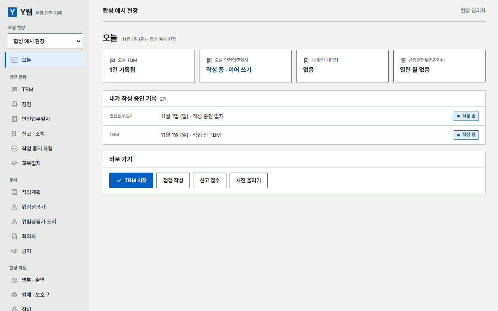
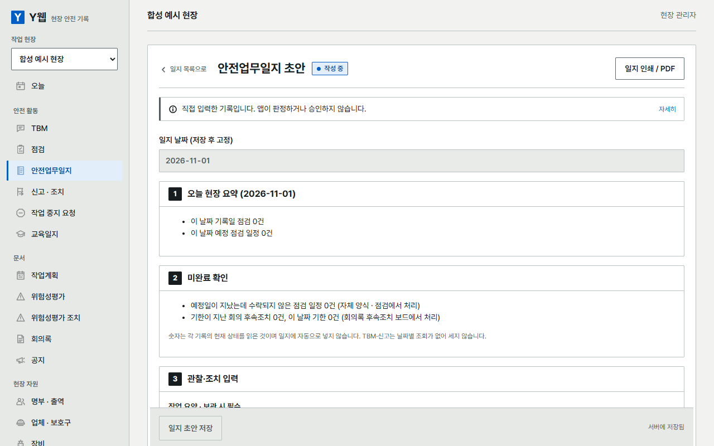
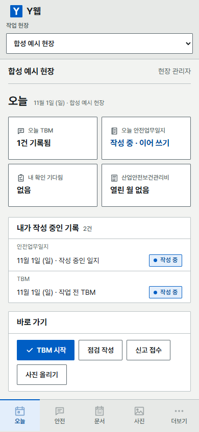
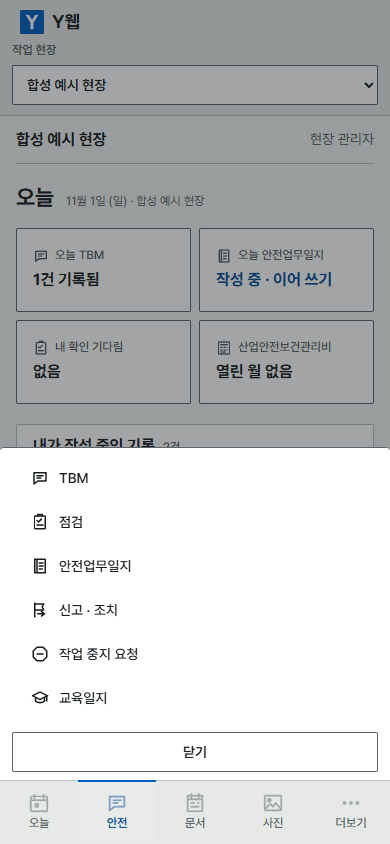

# Y웹 (YWeb)

현장 업무를 한곳에서 기록하기 위한 **개발용 통합 웹앱 소스**입니다. 앱 **0.79.0**, DB·백업 스키마 **71**입니다. 기존 PEDIT 내부 식별자는 호환성을 위해 유지했습니다.

> **먼저 확인해 주세요:** 소스 공개는 운영 서비스 출시나 보안·안전 인증이 아닙니다. 기본은 내 컴퓨터의 `127.0.0.1`에서만 열립니다. 설치한 PC를 서버로 써서 도메인으로 외부 접속을 열 수 있지만([이 PC를 서버로 쓰기](docs/SELF_HOSTING.md)), 전체 독립 보안검토와 실제 PC·모바일·PDF 출력 수용은 아직 완료하지 않았습니다. 장비 계산(P-02)은 기술사 검토를 받지 않았으며 앱 화면에 그 경고를 표시합니다. 홈에는 개발자가 운영하는 광고가 보입니다(설치 PC의 운영자가 끌 수 있음). 광고는 설치된 서버가 글·링크·이미지만 받아 보여 주며 현장 정보를 내보내지 않습니다 — [광고 안내](docs/ADS.md).

## 어떤 기능이 있나요?

- 로그인과 현장별 관리자·작성자·읽기 역할
- 근로자 명부·수기 출역, TBM, 교육내용과 교육일지
- 점검 양식·일정·제출·검토, 위험신고와 조치 기록
- 수기 작업계획·장비·회의록·일지와 고정 기록/정정
- 산업안전보건관리비 사용내역(월마감·증빙 참조·사용내역서 인쇄), 재고·보호구 기록
- 자체 위험성평가 기록, HTML 출력, 명시적 로컬 백업

각 기능은 일부 범위만 구현했습니다. 실제 참석·법정 이수·전자서명·작업허가·공학 안전 판정을 인증하지 않습니다. 교육 원문, 실제 사용자 문서, 운영 DB, 비공개 검토자료는 포함하지 않습니다. 교육91 준비 도구도 원고를 내장하지 않습니다.

## 화면

합성 데이터로 찍은 화면입니다(실제 현장·사람 정보 없음).

| PC · 오늘 | PC · 안전업무일지 |
|---|---|
|  |  |

| 폰 · 오늘 | 폰 · 하단 탭과 메뉴 |
|---|---|
|  |  |

## 준비물

**Node.js 24.x + npm**이 필요합니다. React/TypeScript/Vite + Express + Node 내장 SQLite 구조입니다. Argon2용 플랫폼 바이너리가 없는 환경에서는 C++ 빌드 도구가 필요할 수 있습니다. 잠금파일을 유지하고 `npm ci`로 설치하세요.

## 설치와 실행

**Windows:** Node.js 24.x를 설치한 뒤 프로젝트 폴더의 `start.cmd`를 더블클릭합니다. 처음 실행하면 패키지 설치 → `.env`(무작위 `SESSION_SECRET`) 생성 → 화면 빌드 → 첫 계정 만들기(비밀번호는 화면에 표시되지 않음)까지 하고 서버를 켠 뒤 브라우저를 엽니다. 다음부터는 빌드 후 바로 서버를 켭니다. 창을 닫으면 서버가 꺼집니다.

직접 설치하려면 프로젝트 폴더에서:

```sh
npm ci
cp .env.example .env
node -e "console.log(require('crypto').randomBytes(48).toString('hex'))"
```

출력된 난수를 `.env`의 `SESSION_SECRET`에 넣으세요. 예시 문자열은 사용할 수 없습니다. 비밀값과 `.env`는 공유/commit하지 마세요. PowerShell에서는 `Copy-Item .env.example .env`를 사용합니다.

계정은 공개 가입이 아니라 발급합니다. **앱에서:** 운영자 계정이 아직 없으면 설치한 PC의 브라우저 로그인 화면에 "첫 운영자 만들기"가 보입니다. 운영자는 설치 PC에서만 설정 → 계정 발급으로 계정을 만들고, 비밀번호를 초기화하고, 현장 관리자에게 "계정 발급 권한"을 줄 수 있습니다. 권한을 받은 현장 관리자는 어디서든 현장 관리에서 자기 현장에 들어갈 계정을 만들고 작성자·열람자 비밀번호를 초기화합니다. 모든 발급·초기화는 누가 했는지 기록되고, 초기화는 그 계정의 로그인을 끊습니다. **CLI로도** 발급할 수 있습니다. 비밀번호는12~128자, 명령줄 인수가 아닌 표준입력으로 전달합니다. Bash 예시:

```bash
read -r -s -p '새 비밀번호: ' PASSWORD; echo
printf '%s' "$PASSWORD" | npm run provision -- owner@example.test '테스트 관리자'
unset PASSWORD
npm run build
npm start
```

PowerShell 계정 발급 예시:

```powershell
$secure = Read-Host '새 비밀번호' -AsSecureString
$plain = [System.Net.NetworkCredential]::new('', $secure).Password
$plain | npm run provision -- owner@example.test '테스트 관리자'
Remove-Variable plain, secure
```

**http://127.0.0.1:3000** 에서 로그인 → 현장 생성 → 합성 업무를 작성합니다. `localhost`와 `127.0.0.1`을 섞지 마세요. HMR은 없으므로 프런트 변경 후 다시 빌드합니다. `NODE_ENV=production` 시작은 의도적으로 차단됩니다. Vite의 production build 문구는 운영 배포 승인이 아닙니다.

### 꼭 확인할 로컬 파일 권한

**SEC-LOCAL-01 (P2, 미해결):** 기존0755 데이터 폴더+umask022에서 DB/WAL/SHM이0644가 될 수 있습니다. 상위 경로를 다른 OS 사용자가 탐색할 수 있다면 읽기 노출 위험이 있습니다. 앱이 새로 만든0700 폴더와는 조건이 다릅니다. 실제 사용 전 전용 계정·폴더/파일 소유자·상위 경로·mode/ACL·백업 권한을 검토해야 하며 이 공개본은 자동 해결하지 않습니다.

## 검사

```sh
npm run check
npm run backup:local -- --help
```

`check`는 lint → typecheck → 합성 단위/API 테스트 → build 순서입니다. 원 개발본 최종366개PASS와 공개 staging 결과는 [검증 요약](docs/VALIDATION.md)에 구분합니다. 실제 브라우저/PDF 검사를 대신하지 않습니다. GitHub Actions에는 Node24 설치→npm ci→npm run check만 포함하며 배포/실데이터 작업은 없습니다. 원격 CI 결과는 해당 실행을 별도로 확인하세요.

승인된 환경에서는 다음 E2E 도구를 별도로 실행할 수 있습니다. 최초 공개 준비 단계에서는 미실행했으며, 후속 Windows 실행 결과는 [PC 검증 기록](docs/PC_VALIDATION.md)에 구분합니다.

```sh
npx playwright install chromium
npm run test:e2e
```

E2E는 로컬3107포트·메모리DB·합성 계정만 사용합니다. 테스트 비밀번호를 실제 계정에 재사용하지 마세요.

`test:e2e`는 각 spec을 새 합성 서버에서 순차 실행해 로그인 시도 제한을 유지합니다. 먼저 `npm run build`를 완료하세요. `npm run test:e2e -- --list`는 서버 없이 대상 파일만 나열합니다. 특정 파일은 `npm run test:e2e -- tests/e2e/workflow.spec.ts`처럼 정확한 경로 또는 파일명으로 선택할 수 있습니다. 추가로 지원하는 Playwright 옵션은 `--headed`, `--trace off|on|retain-on-failure`이며 다른 옵션/정규식 필터는 받지 않습니다. 각 spec의 실행 결과가 실패하면 전체 명령도 실패하고, Playwright 증거는 `test-results/e2e-runner/`의 파일별 폴더에 보존됩니다. 기존 Chrome을 쓸 때는 `CHROMIUM_PATH` 환경변수에 실행파일 경로를 지정할 수 있습니다.

## 문서

[남은 작업](HANDOFF.md) · [보안](SECURITY.md) · [로컬 운영](docs/OPERATIONS.md) · [백업](docs/LOCAL_BACKUP_CLI.md) · [검증](docs/VALIDATION.md) · [공개 구성/제외](docs/PUBLICATION_SCOPE.md) · [의존성](docs/DEPENDENCIES.md) · [라이선스](LICENSE)

추가 Windows 수정과 실제 검사 범위는 [PC 검증 기록](docs/PC_VALIDATION.md)에 별도로 기록했습니다. 알PDF·Android 실제 검증 및 남은 보안 gate 완료를 뜻하지 않습니다.

## 라이선스

[MIT 라이선스](LICENSE), Copyright (c) 2026 JO YEONG JIN. 소스 코드와 문서에 적용되며 사용자 원자료·교육 본문·개인 문서·실제 DB 권리는 포함하지 않습니다. 의존성에는 각각의 라이선스가 적용됩니다. `private: true`는 npm 게시 방지용으로 유지합니다. 결정 기록: [LICENSE-PROPOSAL.md](LICENSE-PROPOSAL.md).
